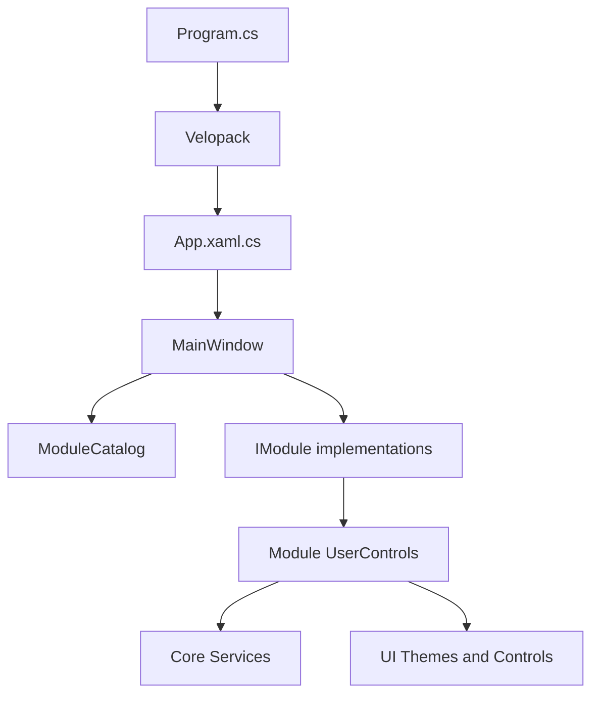

# Arquitectura

## Vista general
Aplicación Windows WPF con punto de entrada propio, ventana principal coordinadora, módulos que implementan IModule, servicios compartidos y recursos visuales XAML.

## Arranque
1. Windows llama a Launcher.Program.Main.
2. VelopackApp.Build().Run() se ejecuta antes de crear WPF.
3. Se crea App y se ejecuta app.Run().
4. App.OnStartup crea evento/mutex de instancia única, registra logging y manejadores globales, aplica acento y abre MainWindow.

## Composición y navegación
MainWindow construye una lista explícita de 13 módulos. ModuleCatalog.Register recibe esa lista. BuildSidebar ordena por Order y genera NavButton. NavigateTo crea la vista mediante CreateView la primera vez y la conserva en `Dictionary<string, UserControl>`; visitas posteriores reutilizan la misma instancia.

Consecuencia: salir de una vista no significa que se destruya. Timers, eventos, COM y procesos deben tener un ciclo de vida explícito.

## Contrato modular
`Core/Interfaces/IModule.cs` define Id, DisplayName, Icon, Order y CreateView() que devuelve UserControl. El contrato está acoplado a WPF y no define activación/desactivación ni Dispose.

## Core
- Interfaces: contratos compartidos.
- Models: modelos de dominio y algunos modelos ligados a UI/WPF/NAudio.
- Services: persistencia, Windows, monitorización, red, audio, IA y actualización.
- Mvvm: ViewModelBase y RelayCommand.
- Converters: conversores WPF.

## MVVM y presentación
Se combina MVVM ligero con code-behind. Algunos modelos implementan INotifyPropertyChanged; otros heredan ViewModelBase. AudioSessionInfo contiene referencia NAudio; otros modelos usan tipos WPF. No hay framework MVVM externo declarado.

## Módulos registrados
Dashboard, Games, Folders, Media, Music, Network, ImageGen, Models, Commands, Devices, Monitor, Processes y Settings. SearchModule existe sin registro. AssistantWindow es una ventana separada, no un módulo.

## Persistencia y servicios
Se utiliza JSON local en varios servicios. La política de escritura no es uniforme; revisar [[../03-Audit/Findings|Hallazgos]]. GameInfoStore mantiene fichas por juego. MusicTrack no se persiste como JSON: se deriva de etiquetas de los archivos de audio.

## Riesgos arquitectónicos
- Registro manual requiere editar MainWindow.
- Caché de vistas mantiene recursos vivos.
- ModuleCatalog es estático/global.
- IModule no tiene contrato de cierre.
- Servicios alternan instancias, estáticos y singletons.
- Algunas operaciones de monitorización pueden ejecutarse en Dispatcher.

No se propone cambiar la arquitectura sin medir el coste y obtener aprobación.
